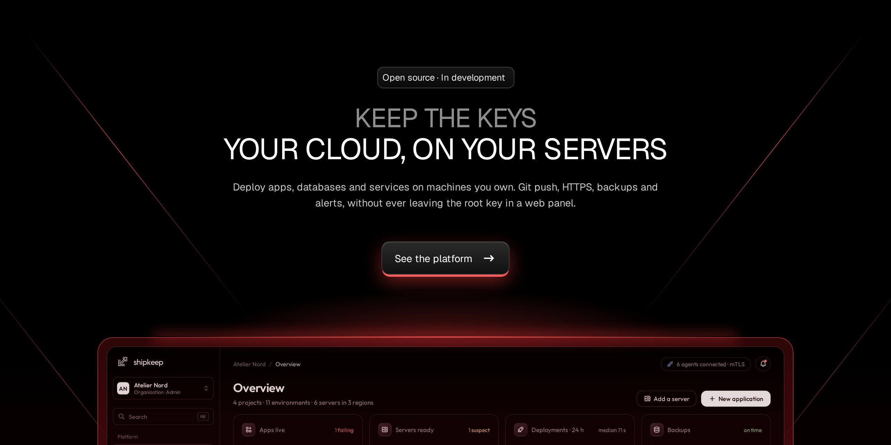
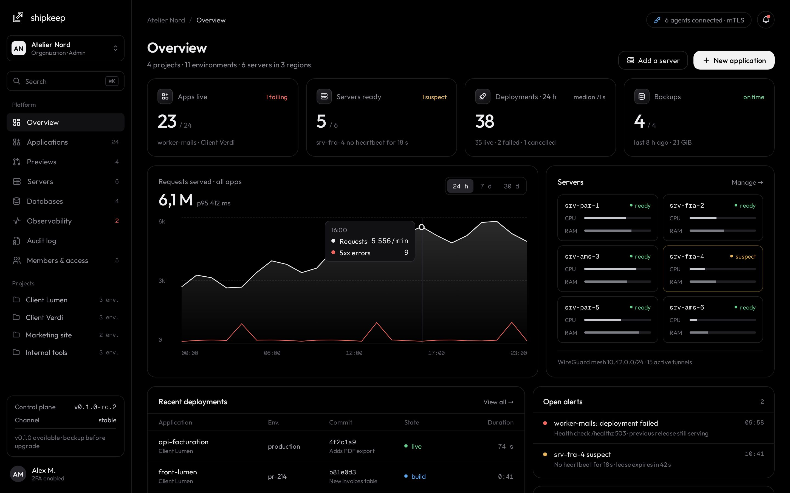
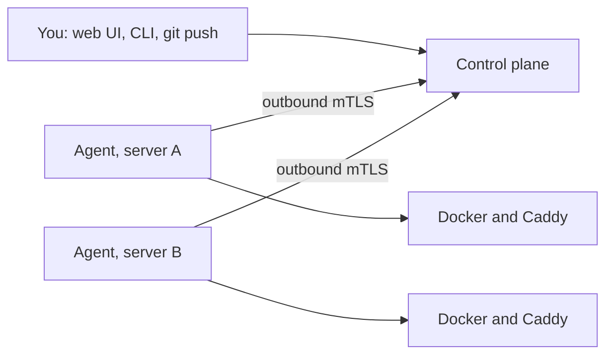

<p align="center">
  <a href="https://shipkeep.vercel.app"></a>
</p>

<p align="center">
  <a href="https://shipkeep.vercel.app"><strong>Website</strong></a> ·
  <a href="docs/PRODUCT.md"><strong>Product brief</strong></a> ·
  <a href="docs/ARCHITECTURE.md"><strong>Architecture</strong></a> ·
  <a href="docs/PLAN.md"><strong>Roadmap</strong></a> ·
  <a href="CONTRIBUTING.md"><strong>Contributing</strong></a>
</p>

<p align="center">
  <a href="LICENSE"></a>
  
  <a href="https://github.com/shipkeepdev/shipkeep/actions/workflows/ci.yml"></a>
  
</p>

# Shipkeep

**Your own cloud on your own servers, without leaving the root key in a web panel.**

Shipkeep is a self-hosted platform to deploy applications, databases and services on servers you own: git push to deploy, automatic HTTPS, managed databases with backups, preview environments, logs, metrics and alerts, without Kubernetes.

> [!NOTE]
> **Shipkeep is in development and cannot be installed yet.** This page describes the first release being built, and [what works today](#what-works-today) says where it stands. It is built in the open under [Apache-2.0](LICENSE), and [contributions are welcome](CONTRIBUTING.md).

## Why Shipkeep

|                         |                                                                                                                                                                     |
| ----------------------- | ------------------------------------------------------------------------------------------------------------------------------------------------------------------- |
| **Secure by design**    | No SSH root key on the control plane, and no shell command built from strings. An agent on each server calls out over mTLS and runs a closed list of typed actions. |
| **Config in your repo** | Each application is described by a versioned `shipkeep.yml`. The UI writes to that file instead of hiding state.                                                    |
| **Real multi-node**     | Placement, health-based failover, a private WireGuard network and replicated routing, without Kubernetes.                                                           |
| **Safe by default**     | Snapshots before upgrades, resumable operations, and explicit confirmation for anything destructive.                                                                |

<p align="center">
  
  <br>
  <sub>Design mockup with fictional data. The web UI in this repository is simpler today.</sub>
</p>

## How it works



Agents connect out to the control plane, so it never needs a key to your servers. Running applications and routing keep working if the control plane goes down.

Describe an application in a file:

```yaml
# shipkeep.yml
version: 1
name: storefront
build:
  type: image
  image: nginx:1.27
run:
  port: 80
```

Then deploy it with the CLI. The API token is read from a prompt or a pipe, never from a flag:

```bash
shipkeep login --url https://shipkeep.example.com
shipkeep deploy --org <id> --project <id> --env <id>
shipkeep status --org <id> --project <id> --env <id>
```

## What works today

| Area                                                                                                       | State                                                                                            |
| ---------------------------------------------------------------------------------------------------------- | ------------------------------------------------------------------------------------------------ |
| Accounts, two-factor authentication, API tokens, roles, audit log                                          | Built, tested against a real database and browser                                                |
| Web UI: organizations, members, servers, applications, deployments, secrets, audit                         | Built, tested in a real browser, except removing a server and a deployment running past `queued` |
| CLI: `login`, `init`, `deploy`, `rollback`, `status`, `secrets`, `server remove`                           | Built, tested against the real API                                                               |
| Agent, deployment pipeline, rollback, routing through Caddy                                                | Built and unit tested. **Not yet run on a real server**                                          |
| Installer                                                                                                  | Draft, waiting for a test server                                                                 |
| Compose applications                                                                                       | Validator built, not connected yet                                                               |
| Git providers, builds, WireGuard network, failover, managed databases, backups, logs and metrics, previews | Planned, see the [roadmap](docs/PLAN.md)                                                         |

Continuous integration runs on every pull request: lint, unit, integration and browser tests, plus security scanners.

## Contributing

Start with [CONTRIBUTING.md](CONTRIBUTING.md) and the [`good first issue`](https://github.com/shipkeepdev/shipkeep/labels/good%20first%20issue) label. Remaining work is tracked in [docs/PLAN.md](docs/PLAN.md) and the GitHub milestones.

## Documentation

- [Product brief](docs/PRODUCT.md)
- [Architecture](docs/ARCHITECTURE.md)
- [Technical specification](docs/SPEC.md)
- [Threat model](docs/THREAT_MODEL.md)
- [Implementation plan](docs/PLAN.md)
- [Architecture decision records](docs/adr/)
- [Contributing guide](CONTRIBUTING.md) and [code of conduct](CODE_OF_CONDUCT.md)
- [Route and role matrix](docs/generated/route-role-matrix.md) (generated)
- [Rules for AI coding assistants](CLAUDE.md)
- [Maintaining the repository](docs/MAINTAINING.md)

## Development

Prerequisites: Node.js 22 (`.nvmrc`), pnpm 11 (`corepack enable` picks the pinned version), Go 1.26+, Docker with Compose v2, and [gitleaks](https://github.com/gitleaks/gitleaks#installing) for the pre-commit hook.

Two commands start everything:

```bash
pnpm install   # dependencies and git hooks
pnpm dev       # PostgreSQL, VictoriaLogs, VictoriaMetrics and a registry in Docker, then the API and the web UI with hot reload
```

The API listens on http://localhost:3000/api/v1/health (OpenAPI document at `/api/v1/openapi.json`, interactive docs at `/api/v1/docs`), the web UI on http://localhost:4200 (it proxies `/api` to the API). Copy `.env.example` to `.env` to change ports or credentials.

For browser development, set `API_PUBLIC_URL=http://localhost:4200` in `.env` (also update older copies of the example). It must match the browser origin exactly; the proxy does not relax Origin or CSRF validation. Configure SMTP to exercise signup and email recovery; unconfigured mail requests fail before creating an account.

Production builds use `pnpm nx run-many -t build -p api web`. Start `node apps/api/dist/main.js` from the repository root with `NODE_ENV=production`, the database/KEK settings and an HTTPS `API_PUBLIC_URL` matching the public reverse proxy. The API serves the browser build from `dist/apps/web/browser`; set `WEB_DIST_DIR` for another packaged layout. Missing/invalid web builds fail startup. HTML uses fresh per-response CSP nonces and must not be cached by a proxy; hashed bundles may be cached immutably. API requests remain under `/api/v1`.

The agent gateway listens on TLS port 7443 (`AGENT_GATEWAY_ADDR`). Set `AGENT_GATEWAY_SERVER_NAME` to the DNS name or IP agents use; it defaults to `localhost`. The installation CA signs a separate server certificate, and agents must pin that CA before sending a join token. Enrollment, certificate renewal and the agent stream are available. Organization administrators issue join tokens with `POST /api/v1/organizations/{organizationId}/join-tokens`, list nodes and remove them with a confirmation token; the installer remains M8.3.

For an agent with an issued join token, copy `deploy/agent/agent.example.yaml`, set its gateway address and CA fingerprint, and set `control_plane.join_token_file` to a private 0600 file containing the token. Run `go run ./agent/cmd/shipkeep-agent --config /absolute/path/agent.yaml`. The agent consumes that file after saving its identity, reconnects after control-plane outages and renews its certificate automatically. `--dev` without a token keeps the unenrolled development process idle; production requires enrollment. The stream currently handles identity and heartbeats; workload execution arrives in later milestones.

Other useful commands:

```bash
pnpm dev:infra         # only the Docker services
pnpm dev:infra:down    # stop them, keep the data
pnpm dev:infra:reset   # stop them and delete the data volumes
pnpm lint              # ESLint + TypeScript typecheck
pnpm test              # TypeScript unit tests (vitest)
pnpm test:integration  # API/PostgreSQL + real Go daemon TLS/restart/revocation tests
pnpm exec playwright install --with-deps chromium  # one-time browser/system setup
pnpm test:browser      # production web build + HTTPS, disposable Postgres and local TLS SMTP
go test ./agent/... ./cli/... ./lib/...
pnpm gen               # regenerate code from proto/ and shipkeep.schema.json
```

Service ports on the host: PostgreSQL 5432, VictoriaLogs 9428, VictoriaMetrics 8428, registry 5000. If one is already taken, set the matching `SHIPKEEP_DEV_*_PORT` in `.env` (see `.env.example`) and adjust both PostgreSQL URLs. Data lives in named Docker volumes. `pnpm dev` provisions a restricted API login after migrations; existing `.env` files need separate runtime and migration URLs as described in [database roles](docs/DATABASE_ROLES.md).

Browser acceptance always creates a fresh PostgreSQL container, even when `DATABASE_URL` is set.
Without Docker, set `SHIPKEEP_DISPOSABLE_DATABASE_URL` to a database that is safe to wipe. Chromium uses the production Angular assets against a loopback HTTPS API
and a local TLS SMTP fixture; no external email is sent. Self-signed certificate acceptance is
limited to that browser context. The suite checks public forms, signup, email verification,
login/logout, cookie/CSRF/Origin boundaries, CSP, automated WCAG rules and horizontal overflow
at widths from 320 to 1440 pixels. Security scenarios cover password reset and code reuse,
session/token invalidation, TOTP and recovery-code login, token creation/revocation, lost-response
retries, concurrent-write prevention and temporary-grant cleanup. Fault injection drops an actual
committed response and throttles its retry; real services and authorization remain enabled.
Browser time advances only for display-expiry checks. The suite records no traces, HAR files or
screenshots. Keyboard scenarios verify the skip link preserves the current form, validation
returns focus to the error summary, and narrow token tables expose their actions after resizing.
The web design system is documented in [apps/web/DESIGN.md](apps/web/DESIGN.md); implementation
and acceptance progress is tracked in [docs/PLAN.md](docs/PLAN.md).
