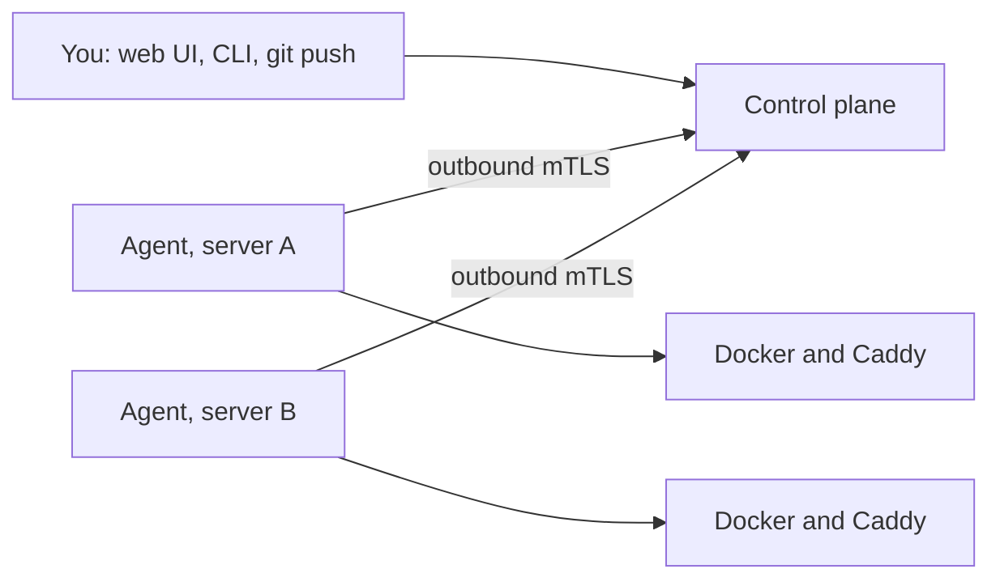

<p align="center">
  <a href="https://shipkeep.vercel.app"></a>
</p>

<p align="center">
  <a href="https://shipkeep.vercel.app"><strong>Website</strong></a> ·
  <a href="docs/PRODUCT.md"><strong>Product brief</strong></a> ·
  <a href="docs/ARCHITECTURE.md"><strong>Architecture</strong></a> ·
  <a href="docs/PLAN.md"><strong>Roadmap</strong></a> ·
  <a href="CONTRIBUTING.md"><strong>Contributing</strong></a> ·
  <a href="https://github.com/shipkeepdev/shipkeep/discussions"><strong>Discussions</strong></a>
</p>

<p align="center">
  <a href="LICENSE"></a>
  
  <a href="https://github.com/shipkeepdev/shipkeep/actions/workflows/ci.yml"></a>
  
</p>

# Shipkeep

**Your own cloud on your own servers, without leaving the root key in a web panel.**

Shipkeep is a self-hosted platform to deploy applications, databases and services on servers you own: git push to deploy, automatic HTTPS, managed databases with backups, preview environments, logs, metrics and alerts, without Kubernetes.

> [!NOTE]
> **Shipkeep is in development and cannot be installed yet.** This page describes the first release being built, and [what works today](#what-works-today) says where it stands. It is built in the open under [Apache-2.0](LICENSE), and [contributions are welcome](CONTRIBUTING.md).

## Why Shipkeep

|                         |                                                                                                                                                                     |
| ----------------------- | ------------------------------------------------------------------------------------------------------------------------------------------------------------------- |
| **Secure by design**    | No SSH root key on the control plane, and no shell command built from strings. An agent on each server calls out over mTLS and runs a closed list of typed actions. |
| **Config in your repo** | Each application is described by a versioned `shipkeep.yml`. The UI writes to that file instead of hiding state.                                                    |
| **Real multi-node**     | Placement, health-based failover, a private WireGuard network and replicated routing, without Kubernetes.                                                           |
| **Safe by default**     | Snapshots before upgrades, resumable operations, and explicit confirmation for anything destructive.                                                                |

<p align="center">
  
  <br>
  <sub>Design mockup with fictional data.</sub>
</p>

## How it works



Agents connect out to the control plane, so it never needs a key to your servers. Running applications and routing keep working if the control plane goes down.

Describe an application in a file:

```yaml
# shipkeep.yml
version: 1
name: storefront
build:
  type: image
  image: nginx:1.27
run:
  port: 80
```

Then deploy it with the CLI. The API token is read from a prompt or a pipe, never from a flag:

```bash
shipkeep login --url https://shipkeep.example.com
shipkeep deploy --org <id> --project <id> --env <id>
shipkeep status --org <id> --project <id> --env <id>
```

## What works today

| Area                                                                                                       | State                                                                                                                                |
| ---------------------------------------------------------------------------------------------------------- | ------------------------------------------------------------------------------------------------------------------------------------ |
| Accounts, two-factor authentication, API tokens, roles, audit log                                          | Built, tested against a real database and browser                                                                                    |
| Web UI: organizations, members, servers, applications, deployments, secrets, audit                         | Built, tested in a real browser, except removing a server and following a deployment to its end                                      |
| CLI: `login`, `init`, `deploy`, `rollback`, `status`, `secrets`, `server remove`                           | Built, tested against the real API                                                                                                   |
| Agent, deployment pipeline, rollback, routing through Caddy                                                | Run end to end in containers on one machine: deployments and a rollback succeed. **Not yet run on a real server**                    |
| Installation: control plane with Docker Compose, servers with one command                                  | Run end to end locally, see the [installation procedure](docs/INSTALL.md). **Not yet on a real server or with a public certificate** |
| Compose applications                                                                                       | Validator built, not connected yet                                                                                                   |
| Git providers, builds, WireGuard network, failover, managed databases, backups, logs and metrics, previews | Planned, see the [roadmap](docs/PLAN.md)                                                                                             |

Continuous integration runs on every pull request: lint, unit, integration and browser tests, plus security scanners.

## Run Shipkeep locally

You need:

- [Node.js 22](https://nodejs.org/), version 22.22.3 or newer (`.nvmrc`), and pnpm 11. Corepack, included with Node.js, installs the right pnpm version.
- [Docker](https://docs.docker.com/get-docker/) with Compose v2, for PostgreSQL and the other local services.

Then follow these steps:

1. **Get the code.**

   ```bash
   git clone https://github.com/shipkeepdev/shipkeep.git
   cd shipkeep
   ```

2. **Install the dependencies.**

   ```bash
   corepack enable
   pnpm install
   ```

3. **Create your configuration file.** It is required, and the values in it work as they are for local development.

   ```bash
   cp .env.example .env
   ```

4. **Start Shipkeep,** and leave this terminal open. The first run downloads the Docker images and takes a few minutes.

   ```bash
   pnpm dev
   ```

   This starts the local services in Docker, applies the database migrations, then starts the API, the web UI with hot reload and a local mail server.

5. **Create your account.** Open <http://localhost:4200/auth/register> and sign up. The verification email appears in the terminal running `pnpm dev`; nothing is really sent. Open its link, paste the code and enter your password.

6. **Create your first organization** when the web UI asks for one. You can then add projects, applications and servers.

To stop, press `Ctrl+C`, then run `pnpm dev:infra:down`. Your data is kept. `pnpm dev:infra:reset` also deletes it.

| Service     | Address                               |
| ----------- | ------------------------------------- |
| Web UI      | <http://localhost:4200>               |
| API health  | <http://localhost:3000/api/v1/health> |
| API docs    | <http://localhost:3000/api/v1/docs>   |
| Agent (TLS) | port 7443                             |

If something goes wrong:

- **`The datasource.url property is required`:** the `.env` file is missing (step 3).
- **`decryption failed` at startup:** `deploy/dev/secrets/kek` no longer matches the database. Run `pnpm dev:infra:reset`, which deletes your local data, then `pnpm dev`.
- **`Service Unavailable` when signing up, or no email in the terminal:** check that `.env` has the `SMTP_*` lines from `.env.example`, then restart `pnpm dev`.
- **A Docker service port is already taken:** set the matching `SHIPKEEP_DEV_*_PORT` in `.env`. For PostgreSQL, also change the port in both database URLs.
- **Port 3000 or 4200 is already taken:** stop the program using it. The web UI and its proxy to the API expect these two ports.
- **Port 1465 is already taken:** change `SMTP_PORT` in `.env`.
- **`Cannot connect to the Docker daemon`:** start Docker, then run `pnpm dev` again.

To send real emails instead, change the `SMTP_*` lines in `.env`. To connect an agent, see [Run an agent](CONTRIBUTING.md#run-an-agent).

## Contribute

1. **Pick an issue.** The [`good first issue`](https://github.com/shipkeepdev/shipkeep/labels/good%20first%20issue) label is the best place to start. Comment on the issue to say you are working on it.
2. **Fork the repository** on GitHub, then clone your fork and add this repository as `upstream`:

   ```bash
   git clone https://github.com/<your-username>/shipkeep.git
   cd shipkeep
   git remote add upstream https://github.com/shipkeepdev/shipkeep.git
   ```

3. **Set up the project.** Run `corepack enable` and `pnpm install`, then [install gitleaks](https://github.com/gitleaks/gitleaks#installing), which the commit hook needs. To run the application, also follow steps 3 to 6 above. Unit tests don't need Docker.
4. **Create a branch** from the latest `main`:

   ```bash
   git fetch upstream
   git switch -c fix/123-short-name upstream/main
   ```

5. **Make your change** and add tests. Read the [rules every change must respect](CONTRIBUTING.md#rules-that-every-change-must-respect) first.
6. **Run the checks:**

   ```bash
   pnpm lint
   pnpm test
   ```

   If you changed Go code, also run `go test ./agent/... ./cli/... ./lib/...` and `golangci-lint run ./agent/... ./cli/... ./lib/...`.

7. **Commit with a sign-off.** The `-s` flag is required, and the message follows [Conventional Commits](https://www.conventionalcommits.org/):

   ```bash
   git commit -s -m "fix(web): describe your change"
   ```

8. **Push and open a pull request** against `main`. Fill in the template and add `Closes #123`.

   ```bash
   git push -u origin fix/123-short-name
   ```

9. **Wait for the checks and a review.** Once both pass, a maintainer squash-merges your pull request.

[CONTRIBUTING.md](CONTRIBUTING.md) has the full rules, all the commands and the test setup.

## Documentation

- [Product brief](docs/PRODUCT.md)
- [Architecture](docs/ARCHITECTURE.md)
- [Technical specification](docs/SPEC.md)
- [Threat model](docs/THREAT_MODEL.md)
- [Implementation plan](docs/PLAN.md)
- [Installation procedure](docs/INSTALL.md), run locally, not yet on a real server
- [Architecture decision records](docs/adr/)
- [Contributing guide](CONTRIBUTING.md) and [code of conduct](CODE_OF_CONDUCT.md)
- [Route and role matrix](docs/generated/route-role-matrix.md) (generated)
- [Rules for AI coding assistants](CLAUDE.md)
- [Maintaining the repository](docs/MAINTAINING.md)
