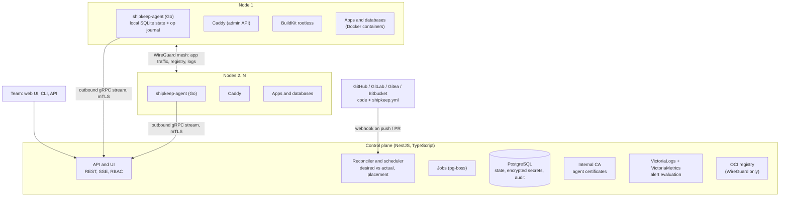

# Shipkeep Architecture

## Overview

The control plane decides and records. Agents execute and route on their own. Every server calls the control plane; the control plane never connects to servers and holds no SSH key.

## Components

### Control plane (`apps/api`, `apps/web`)

- **API**: NestJS. Public REST API (OpenAPI 3.1), Server-Sent Events for live updates, gRPC server for agents.
- **Bounded contexts** (one Nest module each): `identity` (users, sessions, 2FA, OIDC, API tokens), `organizations` (orgs, members, roles, projects, environments), `fleet` (nodes, enrollment, certificates, leases, WireGuard), `apps` (applications, services, shipkeep.yml sync, domains), `deployments` (builds, releases, deployment state machine, rollbacks, previews), `data` (managed databases, volumes, backups, restores), `routing` (routing table computation and distribution), `observability` (log and metric queries, alert rules, notifications), `audit`, `imports` (Coolify import, templates).
- **Reconciler**: compares desired state (from shipkeep.yml and UI) with actual state reported by agents, plans changes, and sends actions to agents. Runs as pg-boss jobs.
- **Scheduler**: places allocations on nodes by filtering (constraints: labels, region, disk, ports) then ranking (spread replicas across nodes, then least loaded).
- **Internal CA**: issues agent client certificates and the control plane server certificate for the agent endpoint.
- **Web UI**: Angular, served as static files by the API process.

### The control plane node

- The server that hosts the control plane is always an enrolled node with the roles `control-plane` and `builder`. Its agent runs and supervises the control plane containers (API, PostgreSQL, registry, VictoriaLogs, VictoriaMetrics) and `buildkitd`, exactly like user workloads.
- This gives the control plane the same supervision, logs, metrics and backups as user apps, and puts the registry and the observability stack on the WireGuard network.
- Control plane maintenance (database backups, upgrades) runs through typed agent actions on that node (`DumpDatabase`, `UpgradeControlPlane`). The NestJS process never spawns processes.

### Agent (`agent/`)

- One Go binary run by systemd as a dedicated `shipkeep` user with membership in the `docker` group, plus two capabilities: `CAP_NET_ADMIN` (WireGuard) and `CAP_NET_BIND_SERVICE` (internal DNS on port 53 of the WireGuard address).
- The binary lives in `/var/lib/shipkeep/bin/` (owned by `shipkeep`) so `UpgradeAgent` can replace it with an atomic rename; the systemd unit uses `Restart=always`, and the agent exits after a successful swap so systemd starts the new version.
- Caddy's admin API listens on `unix//run/shipkeep/caddy-admin.sock|0660`, group `shipkeep`; Caddy's TCP admin endpoint is disabled.
- Containers resolve `*.internal` names because the agent sets their DNS server to the node's WireGuard address, where its embedded DNS answers internal names and forwards everything else to the host's resolvers.
- Note: membership in the `docker` group is root-equivalent. The agent is therefore treated as root in the threat model, which is why its action list is closed and every input is validated.
- Opens a gRPC bidirectional stream to the control plane over mTLS and keeps it alive with reconnect and backoff.
- Executes typed actions (see SPEC, "Agent actions"), journals each one in local SQLite, reports results and actual state.
- Manages: Docker containers, networks and volumes (Docker Engine API); Caddy routes (admin API on a Unix socket); WireGuard interface `shipkeep0`; log and metric shipping.
- Keeps serving routing from its local cache if the control plane is unreachable.

### CLI (`cli/`)

- Go binary `shipkeep`. Talks to the public REST API with a personal or project API token.
- Main commands: `login`, `init` (writes shipkeep.yml), `deploy`, `rollback`, `logs`, `status`, `env`, `secrets`, `db`, `backup`, `preview`, `server add`.

## Key flows

### 1. Server enrollment

1. An Owner or Admin clicks "Add server" and gets a one-time join token (15 min, single use) and a one-line install command.
2. The install script downloads the signed agent binary, verifies its signature (cosign), installs Docker if missing, Caddy and WireGuard tools, and creates the systemd unit.
3. The agent generates an Ed25519 key pair, sends a CSR plus the join token to the control plane.
4. The control plane validates the token, signs a 30-day client certificate, assigns a WireGuard IP and a node lease epoch, and records an audit event.
5. The agent opens its stream, reports facts (CPU, RAM, disk, architecture, Docker version) and receives its WireGuard peer list and routing table.

### 2. Deploy from git

1. Push to the tracked branch triggers a webhook. The API verifies the webhook signature.
2. The `deployments` context reads `shipkeep.yml` at that commit, validates it against the schema, and creates a Deployment in state `queued`.
3. Build: the control plane sends `BuildImage` to a builder node. BuildKit rootless builds, pushes to the internal registry. State `building` then `built`.
4. Release task (migrations) runs once with `RunReleaseTask` if defined.
5. Scheduling: the scheduler picks nodes for each replica.
6. For each replica: `PullImage`, `CreateContainer`, `StartContainer`, then health check. On success, `UpsertRoute` adds the new upstream; the old upstream is removed and drained; the old container is stopped.
7. The routing table is recomputed and pushed to all agents.
8. On failure at any step the deployment moves to `failed` and the previous release keeps serving traffic. No partial switch.

### 3. Request routing

- DNS for an app domain points to one or more nodes (A/AAAA records the user sets, or a load balancer).
- Caddy on the receiving node terminates TLS (Let's Encrypt via HTTP-01 or DNS-01) and proxies to a local healthy instance if any, else to a healthy instance on another node through WireGuard.
- Private service-to-service traffic uses internal DNS names `<app>.<env>.<project>.internal` resolved by the agent's embedded DNS on the WireGuard network.

### 4. Node failure

1. Heartbeats stop. After 15 s the node is `suspect`; routing stops sending new requests to its instances.
2. When the lease expires (60 s default), the node is `down`. Stateless allocations are rescheduled on healthy nodes.
3. Stateful allocations stay put unless the environment policy is `restore-from-backup`; then the latest backup is restored on another node.
4. When the node comes back, the agent checks its lease epoch; if stale, it stops its stateful containers before anything else, then reconciles.

### 5. Control plane upgrade

Triggered from the UI or CLI, executed by the agent on the control plane node through the `UpgradeControlPlane` action.

1. The agent takes a PostgreSQL dump and copies the CA and key files to a timestamped backup folder.
2. It pulls the new signed images, runs migrations in a transaction where possible, starts the new version, and runs smoke checks.
3. On failure it restores the snapshot and starts the previous version.
4. Agents are upgraded afterwards in waves with `UpgradeAgent`, one node at a time, never during an active deployment on that node.

## What we take from the best

| Reference                      | What they do                                                                          | What Shipkeep takes                                                                           |
| ------------------------------ | ------------------------------------------------------------------------------------- | --------------------------------------------------------------------------------------------- |
| Fly.io flyd                    | Per-worker orchestrator, source of truth for its machines, resumes work after restart | Agent local state and resumable operation journal                                             |
| Fly.io fly-proxy and Corrosion | Proxy on every server fed by a gossip-replicated catalog; WireGuard backhaul          | Caddy on every node, replicated routing table, cross-node forwarding over WireGuard           |
| Nomad                          | Job = desired state; heartbeats; allocations; bin packing with constraints            | Evaluation, plan, allocation model; heartbeats; placement constraints; leases before failover |
| Uncloud                        | No control plane, Corrosion, WireGuard mesh with NAT traversal, Caddy, Compose        | NAT traversal; Corrosion evaluation for v0.5                                                  |
| Kamal                          | Proxy switches traffic only to healthy instances, then drains the old one             | Deploy contract: mandatory health check, switch then drain, retained images                   |
| Render                         | Destructive changes need explicit confirmation                                        | Confirmation tokens for every destructive action                                              |

Not taken: running without a control plane (agencies need central UI, RBAC and audit), a custom Raft for control plane HA (PostgreSQL primary plus replica is enough), Firecracker microVMs (too heavy for ordinary VPS).

## Resource targets

| Component                                             | Target   |
| ----------------------------------------------------- | -------- |
| Agent idle RAM                                        | < 50 MB  |
| Control plane idle RAM (API + Postgres)               | < 500 MB |
| Observability stack idle RAM                          | < 300 MB |
| Time from push to live (cached build, small Node app) | < 90 s   |
| Failover of a stateless app after node loss           | < 90 s   |
